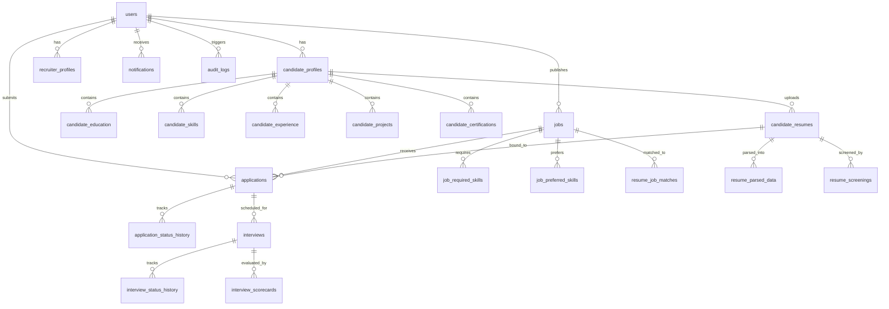

# Resumio Architecture Audit: Current State

**Audit Date**: October 2026  
**Repository State**: Monorepo Transition (Phase 0 Baseline)  
**Target Architecture**: Production-grade, ATS-guided talent intelligence platform measurably superior to open-source Resume-Matcher.

---

## 1. Executive Summary & Technology Stack

Resumio is an enterprise AI resume-matching and recruitment workflow platform.
- **Frontend**: React 19, TypeScript, Vite 8, Tailwind CSS v4, Lucide Icons, Canvas-Confetti, Tabler Icons.
- **Backend**: Node.js Express 4, TypeScript (via `tsx`), better-sqlite3 / sql.js SQLite adapter, Mongoose / MongoDB Atlas integration layer, bcryptjs, JSON Web Tokens (JWT).
- **AI/ML Engine**: Google Gemini API (`@google/generative-ai` SDK) with a multi-component deterministic offline fallback engine and zero-downtime circuit breakers.
- **Data Persistence**: Dual-persistence architecture across 28 SQLite relational tables and MongoDB Atlas document models.

---

## 2. API Routes Catalog

All API endpoints are mounted on `/api` (managed in `server/index.ts`).

| Method | Path | Auth / Role | Validation | Description & Handlers |
|---|---|---|---|---|
| `POST` | `/api/auth/register/candidate` | Public | Zod `candidateRegisterSchema` | Registers candidate user + profile in SQLite + Mongo. |
| `POST` | `/api/auth/register/recruiter` | Public | Zod `recruiterRegisterSchema` | Registers recruiter user + company profile. |
| `POST` | `/api/auth/login` | Public (rate-limited) | Zod `loginSchema` | Authenticates email/password, issues JWT pair. |
| `POST` | `/api/auth/google` | Public | Body schema (Google payload) | Google OAuth SSO account provisioning/linking. |
| `POST` | `/api/auth/refresh` | Public | Body (`refreshToken`) | Session token refresh rotation & revocation check. |
| `POST` | `/api/auth/logout` | Authenticated | Header `Authorization` | Revokes active session tokens. |
| `GET` | `/api/auth/me` | Authenticated | JWT Bearer | Retrieves active authenticated user session & profile. |
| `POST` | `/api/auth/change-password` | Authenticated | Zod `changePasswordSchema` | Verifies current bcrypt hash and updates password. |
| `GET` | `/api/profile/candidate` | Candidate | JWT Bearer | Fetches full candidate profile with skills & history. |
| `PUT` | `/api/profile/candidate` | Candidate | Partial Zod Schema | Updates candidate profile details. |
| `POST` | `/api/candidate/skills` | Candidate | Body (`name`, `proficiency`) | Adds structured candidate skill entry. |
| `DELETE` | `/api/candidate/skills/:id` | Candidate | URL param `:id` | Deletes candidate skill entry. |
| `POST` | `/api/candidate/education` | Candidate | Body (`degree`, `institution`...)| Adds candidate education history. |
| `PUT` | `/api/candidate/education/:id` | Candidate | Body + URL param `:id` | Updates candidate education record. |
| `DELETE` | `/api/candidate/education/:id` | Candidate | URL param `:id` | Deletes candidate education record. |
| `POST` | `/api/candidate/experience` | Candidate | Body (`company`, `jobTitle`...) | Adds candidate experience record. |
| `PUT` | `/api/candidate/experience/:id` | Candidate | Body + URL param `:id` | Updates candidate experience record. |
| `DELETE` | `/api/candidate/experience/:id` | Candidate | URL param `:id` | Deletes candidate experience record. |
| `POST` | `/api/candidate/projects` | Candidate | Body (`name`, `technologies`...) | Adds candidate portfolio project. |
| `PUT` | `/api/candidate/projects/:id` | Candidate | Body + URL param `:id` | Updates candidate portfolio project. |
| `DELETE` | `/api/candidate/projects/:id` | Candidate | URL param `:id` | Deletes candidate portfolio project. |
| `POST` | `/api/candidate/certifications` | Candidate | Body (`name`, `issuingOrg`...) | Adds candidate credential/certificate. |
| `DELETE` | `/api/candidate/certifications/:id` | Candidate | URL param `:id` | Deletes candidate certification. |
| `GET` | `/api/candidate/resumes` | Candidate | JWT Bearer | Lists all resumes uploaded by candidate. |
| `POST` | `/api/candidate/resumes/upload` | Candidate | Multer (PDF, DOCX, TXT <= 10MB) | Uploads resume, parses metadata, stores file. |
| `PUT` | `/api/candidate/resumes/:id/active` | Candidate | URL param `:id` | Flags resume as primary active resume. |
| `DELETE` | `/api/candidate/resumes/:id` | Candidate | URL param `:id` | Deletes resume (if not bound to active app). |
| `GET` | `/api/candidate/resumes/:id/download` | Candidate/Recruiter/Admin | URL param `:id` + RBAC | Downloads resume file with path traversal defense. |
| `POST` | `/api/candidate/resume/rewrite-bullet`| Candidate | Body (`bulletPoint`, `context`)| Rewrites resume bullet into Google XYZ format. |
| `GET` | `/api/candidate/jobs` | Candidate/Public | Query parameters | Filterable candidate job search. |
| `GET` | `/api/candidate/jobs/:id` | Candidate/Public | URL param `:id` | Retrieves full job details & requirements. |
| `GET` | `/api/candidate/jobs/:id/recommendations`| Candidate | JWT Bearer | Recommendations based on candidate skill overlap. |
| `POST` | `/api/candidate/applications` | Candidate | Body (`job_id`, `resume_id`)| Submits immutable job application. |
| `GET` | `/api/candidate/applications` | Candidate | JWT Bearer | Retrieves candidate's submitted applications. |
| `GET` | `/api/candidate/applications/:id` | Candidate | URL param `:id` | Retrieves application status & audit timeline. |
| `DELETE` | `/api/candidate/applications/:id` | Candidate | URL param `:id` | Withdraws submitted job application. |
| `GET` | `/api/recruiter/profile` | Recruiter | JWT Bearer | Fetches recruiter & company profile. |
| `PUT` | `/api/recruiter/profile` | Recruiter | Body schema | Updates recruiter profile & company metadata. |
| `GET` | `/api/recruiter/jobs` | Recruiter | JWT Bearer | Lists jobs published by authenticated recruiter. |
| `POST` | `/api/recruiter/jobs` | Recruiter | Zod `jobCreateSchema` | Publishes new job requisition with skills. |
| `GET` | `/api/recruiter/jobs/:id` | Recruiter | URL param `:id` | Retrieves specific job details. |
| `PUT` | `/api/recruiter/jobs/:id` | Recruiter | Zod `jobUpdateSchema` | Edits job requisition. |
| `DELETE` | `/api/recruiter/jobs/:id` | Recruiter | URL param `:id` | Closes / deletes job requisition. |
| `GET` | `/api/recruiter/jobs/:id/applicants` | Recruiter | URL param `:id` + Query | Retrieves applicants with match scoring & filters. |
| `GET` | `/api/recruiter/applicants/:appId` | Recruiter | URL param `:appId` | Fetches applicant profile & match breakdown. |
| `PUT` | `/api/recruiter/applications/:id/status`| Recruiter | Body (`status`, `note`) | Transitions applicant pipeline status. |
| `POST` | `/api/recruiter/interviews` | Recruiter | Body (`application_id`, date...)| Schedules candidate interview. |
| `GET` | `/api/recruiter/interviews` | Recruiter | JWT Bearer | Lists recruiter scheduled interviews. |
| `PUT` | `/api/recruiter/interviews/:id` | Recruiter | Body (date, meeting link...) | Reschedules or updates interview details. |
| `POST` | `/api/recruiter/interviews/:id/scorecard`| Recruiter | Body (rubric scores 1-5) | Submits structured 5-point interview scorecard. |
| `GET` | `/api/recruiter/interviews/:id/scorecard`| Recruiter | URL param `:id` | Fetches interview scorecard. |
| `GET` | `/api/recruiter/analytics` | Recruiter | Query (`dateRange`) | Recruiter pipeline analytics & Predictive ROI. |
| `GET` | `/api/admin/stats` | Admin | Role = 'admin' | System-wide statistics and usage telemetry. |
| `GET` | `/api/admin/users` | Admin | Role = 'admin' | Paginated user management table. |
| `PUT` | `/api/admin/users/:id/status` | Admin | Role = 'admin' | Suspends / activates user accounts. |
| `POST` | `/api/admin/chaos/inject` | Admin | Body (`rule`) | SRE Chaos Engineering fault injection. |
| `POST` | `/api/admin/chaos/clear` | Admin | None | Clears active SRE chaos injection rules. |
| `POST` | `/api/admin/sre/drain` | Admin | Body (`draining`: boolean) | Signals pod blue-green graceful traffic drain. |
| `GET` | `/api/events/stream` | Authenticated | SSE Header | Real-time Server-Sent Events stream. |
| `POST` | `/api/presence/touch` | Authenticated | Body (`candidateId`, `user`) | Touch recruiter presence on profile. |
| `POST` | `/api/presence/leave` | Authenticated | Body (`candidateId`, `userId`)| Releases recruiter presence lock. |
| `GET` | `/api/presence/:candidateId` | Authenticated | URL param `:candidateId` | Gets recruiters currently viewing candidate. |
| `POST` | `/api/compliance/anonymize` | Authenticated | Body (`candidate`) | Anonymizes PII for EEOC/GDPR blind hiring. |
| `GET` | `/health`, `/healthz`, `/api/health` | Public | None | SRE Liveness Probe & telemetry. |
| `GET` | `/ready`, `/readyz`, `/api/ready` | Public | None | SRE Deep Dependency Readiness Probe. |

---

## 3. Services Inventory & Roles

1. **`aiProvider.ts`**: Google Gemini API client with retry budget, exponential backoff, request timeouts, and deterministic fallback.
2. **`aiValidation.ts`**: Zod parser and JSON sanitization pipeline for LLM outputs.
3. **`analyticsService.ts`**: Computes time-to-hire velocity, cost savings, AI screening hours, and recruiter funnel metrics.
4. **`auditService.ts`**: Records immutable state change logs into `audit_logs` table.
5. **`cacheService.ts`**: In-memory LRU cache with hit/miss telemetry, TTL expirations, and tag-based invalidations.
6. **`candidateSummaryService.ts`**: Synthesizes 3-bullet candidate snapshot evaluations.
7. **`cloudStorageAdapter.ts`**: Pre-signed file storage interface supporting Local Filesystem, AWS S3, and Google Cloud Storage.
8. **`complianceAnonymizationShield.ts`**: Strips PII, neutralizes pronouns, defangs age markers, and masks university/employer prestige for EEOC/GDPR blind screening.
9. **`dashboardService.ts`**: Aggregates role-specific metrics for candidates, recruiters, and admins.
10. **`distributedJobQueue.ts`**: Memory-backed async job queue for CPU-intensive resume parsing and embeddings with SSE progress broadcasts.
11. **`documentExtractor.ts`**: Extracts raw text from uploaded PDF, DOCX, and TXT files.
12. **`duplicateResumeService.ts`**: SHA-256 and Jaccard token set similarity algorithm for detecting duplicate/plagiarized resumes.
13. **`interviewQuestionService.ts`**: Generates structured 4-category interview questions tailored to job skills.
14. **`interviewService.ts`**: Manages interview scheduling lifecycle, rescheduling, audit logs, and 5-point scorecards.
15. **`jobDescriptionParser.ts`**: Extracts required/preferred skills and experience thresholds from raw job description text.
16. **`matchExplanationService.ts`**: Produces transparent, explainable natural-language match breakdowns.
17. **`matchingConfig.ts`**: Model weights, prompt security boundaries, and lexical cosine vector similarity.
18. **`matchingService.ts`**: 5-component deterministic resume-job scoring engine (BM25 + Semantic Cosine + RRF).
19. **`nlSearchService.ts`**: Natural language search engine with anti-bias guardrails intercepting protected characteristics.
20. **`notificationService.ts`**: Dispatches in-app notifications and manages unread counts.
21. **`promptSecurity.ts`**: Detects prompt injection payloads, system prompt overrides, and delimiters.
22. **`realtimeEventBus.ts`**: SSE event broadcaster with 45s heartbeat auto-pruning and recruiter collision detection.
23. **`researchAugmentation.ts`**: Generates synthetic benchmark candidate profiles for research evaluation.
24. **`researchClassifier.ts`**: Evaluates classification performance on augmented research datasets.
25. **`researchEvaluationService.ts`**: Computes precision, recall, F1, and NDCG benchmark metrics.
26. **`researchPreprocessing.ts`**: Preprocesses benchmark resumes and jobs for evaluation.
27. **`researchSplitter.ts`**: Splits datasets into stratified train/test partitions.
28. **`resilienceService.ts`**: Cloud-Native 3-state Circuit Breakers (`CLOSED`, `OPEN`, `HALF_OPEN`), chaos fault-injection, and blue-green graceful drain controls.
29. **`resumeImprovementService.ts`**: Career Copilot engine rewriting bullet points into Google's Accomplished [X] as measured by [Y] by doing [Z] format.
30. **`resumeParser.ts`**: Multi-section heuristic and regex parser extracting education, experience, skills, and certifications.
31. **`resumeProcessingPipeline.ts`**: Coordinates document extraction, parsing, duplicate checking, and screening.
32. **`resumeScreening.ts`**: Evaluates candidate fitness and produces screening summary.
33. **`securitySessionService.ts`**: Token session rotation, refresh tokens, and rate-limiting enforcement.
34. **`skillGapService.ts`**: Identifies critical skill gaps and provides learning recommendations.
35. **`skillNormalizer.ts`**: Normalizes skill synonyms against a 400+ entry canonical skills registry.

---

## 4. Database Schema (28 Tables)

### Table Definitions & Primary Relationships:
1. `users`: Base identity (`id`, `email`, `password_hash`, `role`, `status`, `google_id`, `created_at`).
2. `candidate_profiles`: User profile data (`id`, `user_id`, `full_name`, `phone`, `location`, `headline`, `bio`, `profile_completion`).
3. `recruiter_profiles`: Employer profile data (`id`, `user_id`, `full_name`, `company_name`, `industry`, `location`, `website`).
4. `candidate_education`: Degrees, institutions, GPA, date ranges (`candidate_profile_id`).
5. `candidate_skills`: Verified candidate skills and proficiency levels (`candidate_profile_id`).
6. `candidate_experience`: Work history, employer, role, accomplishments (`candidate_profile_id`).
7. `candidate_projects`: Portfolio projects, technologies, repository URLs (`candidate_profile_id`).
8. `candidate_certifications`: Credentials, issuing bodies, expiration dates (`candidate_profile_id`).
9. `candidate_resumes`: Uploaded resume metadata, storage path, file hash, active flag (`candidate_profile_id`).
10. `jobs`: Requisitions, compensation, work mode, experience requirements (`recruiter_id`).
11. `job_required_skills`: Mandatory skills required for job (`job_id`).
12. `job_preferred_skills`: Optional/preferred skills for bonus points (`job_id`).
13. `applications`: Candidate job applications immutably bound to specific resume version (`job_id`, `candidate_id`, `resume_id`).
14. `application_status_history`: Audit trail of candidate pipeline transitions (`application_id`, `changed_by`).
15. `resume_parsed_data`: Structured extracted resume JSON (`resume_id`, `candidate_id`).
16. `resume_screenings`: AI screening score, recommendations, strengths (`resume_id`, `job_id`).
17. `resume_job_matches`: Detailed multi-component match scores (`job_id`, `resume_id`, `candidate_id`).
18. `candidate_job_summaries`: AI-synthesized snapshot summaries (`candidate_id`, `job_id`).
19. `skill_gap_analyses`: Missing skill analysis and learning paths (`candidate_id`, `job_id`).
20. `interviews`: Scheduled interviews, meeting URLs, duration, status (`application_id`, `recruiter_id`, `candidate_id`).
21. `interview_status_history`: History of interview schedule modifications (`interview_id`).
22. `notifications`: In-app candidate notifications (`user_id`).
23. `natural_language_searches`: Recruiter search queries and matched candidate results (`recruiter_id`).
24. `interview_question_sets`: Generated technical and behavioral interview questions (`job_id`).
25. `resume_improvement_analyses`: Career Copilot suggestions and section health scores (`resume_id`).
26. `resume_duplicate_matches`: Plagiarism and collision scores between uploaded resumes (`resume_id`, `matched_resume_id`).
27. `audit_logs`: Enterprise compliance audit trail (`actor_id`, `action`, `target_type`, `target_id`).
28. `interview_scorecards`: 5-point structured recruiter interview rubrics and hiring recommendation (`interview_id`, `recruiter_id`).

---

## 5. Match Scoring Engine & Mathematical Formulation

Resumio uses an explainable multi-component scoring model (`MATCHING_MODEL_CONFIG` v2.0.0 in `server/services/matchingConfig.ts` & `server/services/matchingService.ts`):

$$\text{Final Score} = S_{\text{req}} + S_{\text{pref}} + S_{\text{exp}} + S_{\text{qual}} + S_{\text{sem}}$$

### Component Weights & Normalization Formulas:
1. **Required Skills ($45\%$ maximum)**:
   $$S_{\text{req}} = 45 \times \frac{|\text{Matched Required Skills}|}{|\text{Total Required Skills}|}$$
   - Skills are matched using canonical normalization via `SkillNormalizer` (e.g. "ReactJS" $\rightarrow$ "react", "Node" $\rightarrow$ "node.js").
2. **Preferred Skills ($15\%$ maximum)**:
   $$S_{\text{pref}} = 15 \times \frac{|\text{Matched Preferred Skills}|}{|\text{Total Preferred Skills}|}$$
   - If a job specifies zero preferred skills, the full 15 points are awarded proportionally so candidates are not penalized.
3. **Experience Duration & Level ($20\%$ maximum)**:
   - Evaluates candidate calculated years of experience against `min_experience` and `max_experience`:
     - If $\text{exp} \ge \text{min_experience}$: Full 20 points.
     - If $\text{exp} < \text{min_experience}$: Penalized linearly down to a baseline of 5 points.
4. **Qualification & Education ($10\%$ maximum)**:
   - Hierarchy rank: PhD (100%) $\ge$ Master's (90%) $\ge$ Bachelor's (80%) $\ge$ Associate (60%) $\ge$ High School (40%).
   - Awards full 10 points if candidate degree meets or exceeds job degree threshold.
5. **Semantic & Lexical Relevance ($10\%$ maximum)**:
   - Computes TF-IDF cosine similarity between candidate resume summary/experience text and the job description/responsibilities:
     $$S_{\text{sem}} = 10 \times \text{CosineSimilarity}(\vec{V}_{\text{resume}}, \vec{V}_{\text{job}})$$

Every score displayed to the recruiter or candidate provides full mathematical lineage and matched/missing evidence spans.

---

## 6. Gemini Integration & Deterministic Fallbacks

Resumio never crashes if the Gemini API key is missing, network calls fail, or rate limits occur:
- **Client**: `AIProviderService` wraps Google Generative AI (`gemini-1.5-flash`).
- **Resilience**: 3-state Circuit Breaker (`CLOSED`, `OPEN`, `HALF_OPEN`) with max 2 retries, 10s execution budget.
- **Deterministic Offline Fallback**:
  - **Match Scoring**: TF-IDF lexical cosine similarity + Jaccard token overlap + exact canonical dictionary matching.
  - **Interview Questions**: Pre-computed repository of high-yield technical and behavioral questions mapped to specific verified skills.
  - **Candidate Summaries**: Deterministic template synthesis pulling matched skill counts, highest education attained, and total years of verified experience.
  - **Bullet Rewriter**: Rule-based action verb substitution, metric token identification, and Google XYZ syntactic restructuring.

---

## 7. Resume Parsing Pipeline

1. **Upload & File Sanitization**:
   - Multer middleware validates MIME type (`application/pdf`, `application/vnd.openxmlformats-officedocument.wordprocessingml.document`, `text/plain`) and file size limit ($10\text{ MB}$).
   - SHA-256 file hash is computed immediately to detect exact duplicates before processing.
2. **Document Text Extraction (`documentExtractor.ts`)**:
   - Fast plain text and raw stream decoding.
3. **Heuristic & Taxonomy Parsing (`resumeParser.ts`)**:
   - Section segmentation identifies `Summary`, `Experience`, `Education`, `Skills`, `Projects`, `Certifications`.
   - Contact info extracted via targeted regex (RFC 5322 email patterns, E.164 phone patterns).
   - Skills identified and mapped through `SkillNormalizer` against 400+ canonical technical and professional taxonomy entries.
4. **Plagiarism & Duplicate Detection (`duplicateResumeService.ts`)**:
   - Computes Jaccard word set similarity across all resumes in the database.
   - Flags matches $\ge 85\%$ as "Likely Duplicate" or "Exact Duplicate".
5. **Persistence**:
   - Structured JSON stored in `resume_parsed_data` table and dual-persisted into MongoDB Document Store.

---

## 8. Security & Rate Limiting

- **Rate Limiting (`server/middleware/security.ts`)**:
  - Auth routes: 100 requests / 15 minutes window.
  - AI processing routes: 120 requests / 5 minutes window.
- **Security Headers**:
  - Content Security Policy (CSP), X-Frame-Options (`DENY`), X-Content-Type-Options (`nosniff`), Strict-Transport-Security (`HSTS`), Referrer-Policy.
- **Prompt Injection Defense (`server/services/promptSecurity.ts`)**:
  - Inspects user input for adversarial overrides (`ignore previous instructions`, `system prompt:`, `override safety rules`).
  - Defangs adversarial tokens and encapsulates untrusted input within XML delimiters (`<untrusted_resume_content>`).
- **Path Traversal Defense**:
  - Download endpoints sanitize file names with `path.basename()` and verify that resolved paths reside strictly within the permitted uploads directory.

---

## 9. Test Suite Inventory & Baseline Status

Resumio maintains 17 comprehensive test suites executed via `npm test` (`tsx server/test-all.ts`):

| # | Test Suite | File | Coverage & Scope | Baseline Result |
|---|---|---|---|---|
| 1 | Phase 1 - Database, Auth & Profiles | `server/test-phase1.ts` | User registration, bcrypt hash, JWT issue, profile completion | ✅ PASSED (956ms) |
| 2 | Phase 2 - Candidate & Recruiter Profiles | `server/test-phase2.ts` | Deep profile CRUD, skills, education, experience, recruiter company | ✅ PASSED (1135ms) |
| 3 | Phase 2 - MongoDB Architecture & Models | `server/test-mongodb.ts` | Dual-persistence Mongo models and document schemas | ✅ PASSED (1350ms) |
| 4 | Phase 3 - Job Management & Discovery | `server/test-phase3.ts` | Job posting lifecycle, required/preferred skills, candidate search | ✅ PASSED (781ms) |
| 5 | Phase 3 - MongoDB Persistence Verifier | `server/scripts/verify-atlas-persistence.ts`| Live Atlas connectivity, collections, document count validation | ✅ PASSED (956ms) |
| 6 | Phase 4 - Production AI Foundation | `server/test-ai-foundation.ts` | Gemini SDK provider, timeout budgets, offline fallbacks | ✅ PASSED (15464ms) |
| 7 | Phase 4 - Application Workflow & Tracking | `server/test-phase4.ts` | Job applications, candidate withdrawal, recruiter pipeline review | ✅ PASSED (1129ms) |
| 8 | Phase 5 - LLM Research Pipeline | `server/test-research-pipeline.ts` | Synthetic augmentation, classification, precision/recall/F1 | ✅ PASSED (16586ms) |
| 9 | Phase 5 - Resume Parsing & Screening | `server/test-phase5.ts` | Text extraction, section parser, skill normalization | ✅ PASSED (935ms) |
| 10 | Phase 6 - AI Matching & Ranking | `server/test-phase6.ts` | 5-tier scoring, required/preferred skill math, experience penalties | ✅ PASSED (4798ms) |
| 11 | Phase 6 - Advanced Matching Engine | `server/test-advanced-matching.ts` | TF-IDF semantic cosine, explainability evidence generation | ✅ PASSED (944ms) |
| 12 | Phase 7 - Interviews, Notifications & Analytics | `server/test-phase7.ts` | Interview scheduling, in-app notifications, pipeline analytics | ✅ PASSED (1123ms) |
| 13 | Phase 8 - Deployment Readiness | `server/test-deployment-readiness.ts` | Dockerfile, render.yaml, vercel.json, .env.example validation | ✅ PASSED (794ms) |
| 14 | Phase 8 - Advanced Recruitment AI | `server/test-phase8.ts` | Natural language candidate search, anti-bias guardrail intercepts | ✅ PASSED (16693ms) |
| 15 | Phase 9 - Security & Master Integration | `server/test-phase9.ts` | 97 assertions covering RBAC, IDOR, tamper checks, SRE breakers | ✅ PASSED (13429ms) |
| 16 | Phase 10 - Research Experimentation | `server/test-phase10.ts` | Cross-validation, ranking metrics (NDCG@K), accuracy benchmarks | ✅ PASSED (13014ms) |
| 17 | Phase 11 - Full-System Smoke Validation | `server/test-phase11-smoke.ts` | End-to-end recruitment lifecycle from register to hire with 0 mocks | ✅ PASSED (1252ms) |

**Baseline Summary**: **17 / 17 (100%) test suites passing** across all operational features.

---

## 10. Identified Architectural Weaknesses (To Address in Foundation Phases)

1. **Direct Route SQL Coupling**:
   - Route handlers (e.g. `server/routes/candidate.ts`, `server/routes/jobs.ts`, `server/routes/applications.ts`) execute raw `db.prepare(...)` SQL queries inline without an abstract repository pattern.
   - *Impact*: Tightly couples the API layer to SQLite syntax, preventing seamless migration to PostgreSQL.
2. **Missing Database Migration Framework**:
   - Database schema is created via `schema.sql` inside `initDatabase()`, using manual `ALTER TABLE` checks (e.g. `db.ts:148`).
   - *Impact*: Schema evolution cannot be tracked in version control or rolled back deterministically.
3. **Monolithic Directory Structure**:
   - The repository co-locates client (`src/`), server (`server/`), and research pipelines in a flat layout rather than typed monorepo workspaces (`apps/web`, `apps/api`, `packages/shared`, `services/ml`).
   - *Impact*: Shared types and validation schemas are duplicated between client and server.
4. **FastAPI ML Service Separation**:
   - The AI/ML parsing and matching logic currently runs in-process inside Node.js.
   - *Impact*: Heavy NLP parsing and vector computations contend with Express event loop workers for CPU cycles.
5. **Structured Logging & RFC 9457 Errors**:
   - Errors are returned as `{ success: false, message: string }` instead of RFC 9457 `application/problem+json` standard.
   - Logging uses raw `console.log` rather than structured `pino` with automatic PII redaction (risk of logging candidate names or emails).
6. **Environment Configuration Validation**:
   - `process.env` properties are read throughout the codebase with ad-hoc fallbacks rather than failing fast at boot with a centralized, typed Zod configuration schema.
