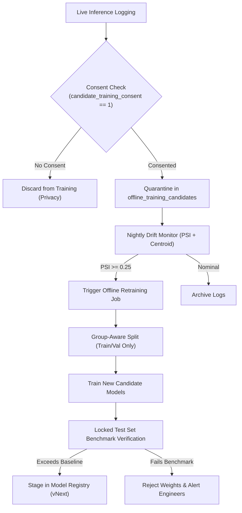

# Resumio Machine Learning Feedback Loop & Drift Monitoring Architecture

## 1. Overview & Principles

Resumio strictly prohibits online learning in production to prevent reward gaming, catastrophic forgetting, or runaway bias amplification. Instead, candidate interactions, recruiter decisions, and hiring outcomes are recorded securely into structured audit tables for **scheduled, batch-oriented offline retraining** guarded by human validation and locked benchmark evaluation.

### Core Safeguards
1. **Candidate Affirmative Consent:** Candidate profile and application data is only eligible for training splits if `candidate_training_consent = 1` (opt-in established in Phase 3).
2. **Deterministic Versioning:** All scores stamped with immutable model versions (`model_version`).
3. **Audit Trail:** Recruiter overrides are logged with structured reason codes.

---

## 2. Relational Database Schema (`better-sqlite3`)

```sql
-- Recruiter Overrides and Interaction Logs
CREATE TABLE IF NOT EXISTS recruiter_decision_logs (
    id TEXT PRIMARY KEY,
    recruiter_id TEXT NOT NULL,
    candidate_id TEXT NOT NULL,
    job_id TEXT NOT NULL,
    model_score REAL NOT NULL,
    model_version TEXT NOT NULL,
    decision_type TEXT NOT NULL CHECK(decision_type IN ('shortlist', 'interview', 'reject', 'hire', 'override')),
    override_reason TEXT,
    recruiter_notes TEXT,
    created_at DATETIME DEFAULT CURRENT_TIMESTAMP,
    FOREIGN KEY(candidate_id) REFERENCES candidates(id),
    FOREIGN KEY(job_id) REFERENCES jobs(id)
);

-- Offline Retraining Dataset Candidate Pool (Consent-Gated)
CREATE TABLE IF NOT EXISTS offline_training_candidates (
    id TEXT PRIMARY KEY,
    candidate_id TEXT NOT NULL,
    job_id TEXT NOT NULL,
    consent_granted INTEGER NOT NULL DEFAULT 0,
    features_json TEXT NOT NULL,
    final_outcome TEXT CHECK(final_outcome IN ('hired', 'rejected_offer', 'rejected_technical', 'rejected_cultural', 'withdrawn')),
    recorded_at DATETIME DEFAULT CURRENT_TIMESTAMP,
    is_exported_to_split INTEGER NOT NULL DEFAULT 0
);

-- Drift Telemetry Logs
CREATE TABLE IF NOT EXISTS model_drift_metrics (
    id TEXT PRIMARY KEY,
    model_name TEXT NOT NULL,
    model_version TEXT NOT NULL,
    evaluation_window_start DATETIME NOT NULL,
    evaluation_window_end DATETIME NOT NULL,
    total_samples INTEGER NOT NULL,
    psi_score REAL NOT NULL,
    ks_test_p_value REAL NOT NULL,
    centroid_drift_distance REAL NOT NULL,
    alert_level TEXT NOT NULL CHECK(alert_level IN ('nominal', 'warning', 'critical')),
    created_at DATETIME DEFAULT CURRENT_TIMESTAMP
);

CREATE INDEX IF NOT EXISTS idx_recruiter_decisions_cand ON recruiter_decision_logs(candidate_id);
CREATE INDEX IF NOT EXISTS idx_recruiter_decisions_job ON recruiter_decision_logs(job_id);
CREATE INDEX IF NOT EXISTS idx_drift_model_timestamp ON model_drift_metrics(model_name, created_at);
```

---

## 3. Drift Monitoring Algorithms

### A. Score Distribution Shift (Population Stability Index - PSI)
Measures the divergence between the baseline validation score distribution ($B$) and the live 30-day inference window ($T$):

$$\text{PSI} = \sum_{b=1}^{K} \left( \text{Actual}_b - \text{Expected}_b \right) \times \ln\left( \frac{\text{Actual}_b}{\text{Expected}_b} \right)$$

- **$\text{PSI} < 0.10$:** Nominal (No significant change).
- **$0.10 \le \text{PSI} < 0.25$:** Warning (Moderate distribution shift; monitor).
- **$\text{PSI} \ge 0.25$:** Critical Alert (Significant drift detected; trigger scheduled offline retraining pipeline).

### B. Statistical Two-Sample Kolmogorov-Smirnov Test
Tests the null hypothesis that live candidate match scores originate from the same continuous distribution as the validation cohort:
- A $p\text{-value} < 0.01$ indicates statistically significant divergence.

### C. Embedding Representation Centroid Drift
Computes the Euclidean and Cosine drift between the baseline corpus centroid ($\mu_{\text{baseline}}$) and the live inference embedding centroid ($\mu_{\text{live}}$):

$$D_{\text{centroid}} = 1.0 - \frac{\mu_{\text{baseline}} \cdot \mu_{\text{live}}}{\|\mu_{\text{baseline}}\| \|\mu_{\text{live}}\|}$$

- If $D_{\text{centroid}} > 0.15$, trigger a **Vocabulary Shift Alert** (indicating emerging industry skills or novel role phrasing).

---

## 4. Retraining Workflow Lifecycle


