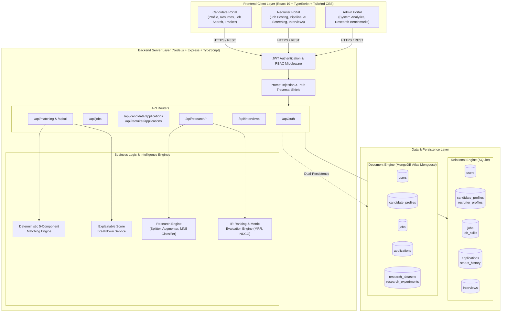
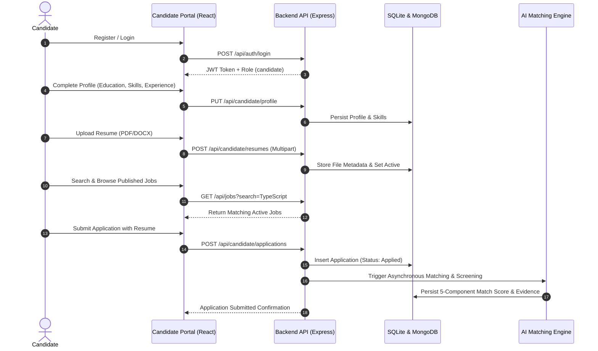
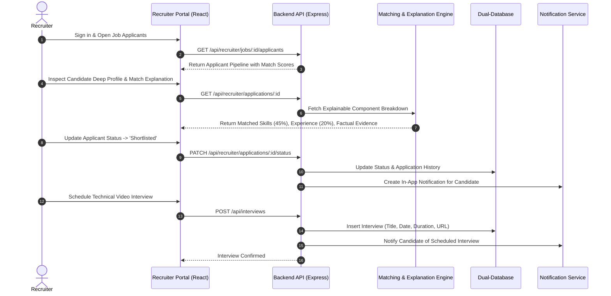
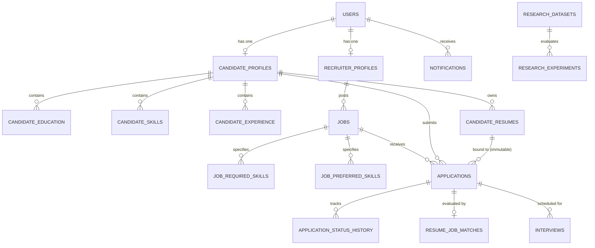
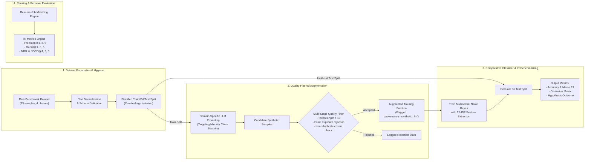

# System Architecture & Diagrams (Phase 12 Final Documentation)

**Project:** Resumio — AI Resume Screening & Recruitment Portal  
**Architecture Pattern:** Three-Tier Architecture with Dual-Database Persistence & Isolated Research Engine  

---

## 1. High-Level System Architecture

---

## 2. Candidate Journey Flowchart

---

## 3. Recruiter Screening & Interview Management Flowchart

---

## 4. Logical Data Relationships (ER-Style Diagram)

*Note: The following represents the logical entity relationships across Resumio's dual-database persistence architecture.*

---

## 5. Research Data Augmentation & Evaluation Pipeline Architecture

